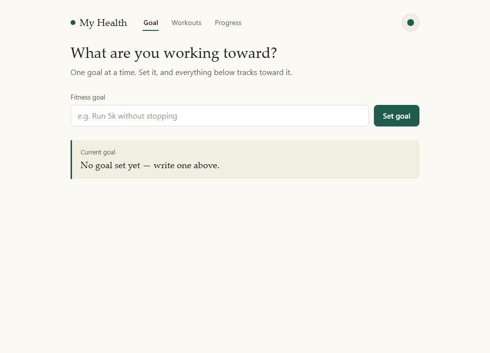
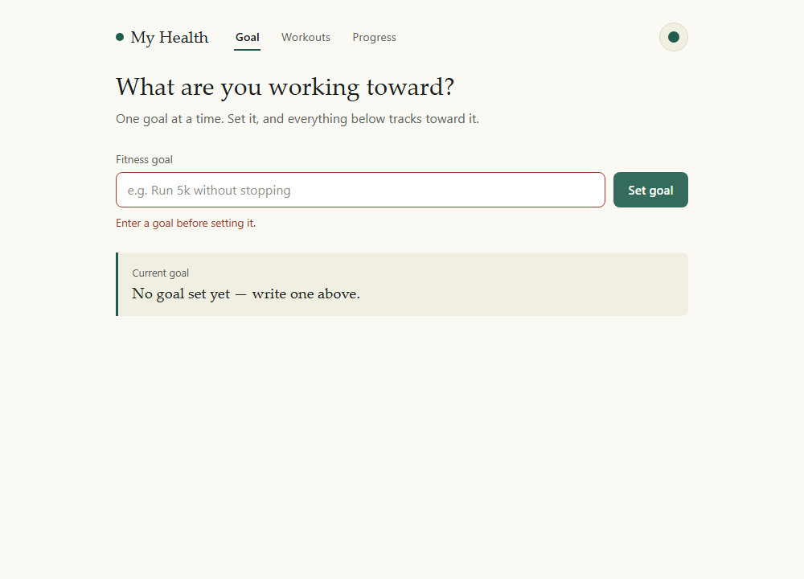
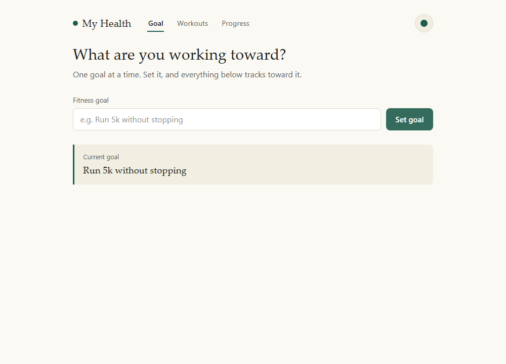
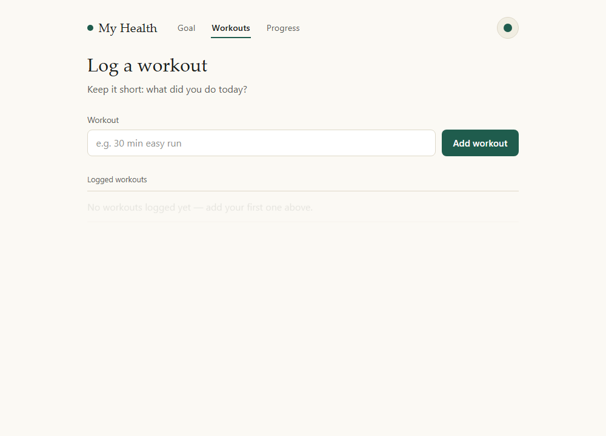
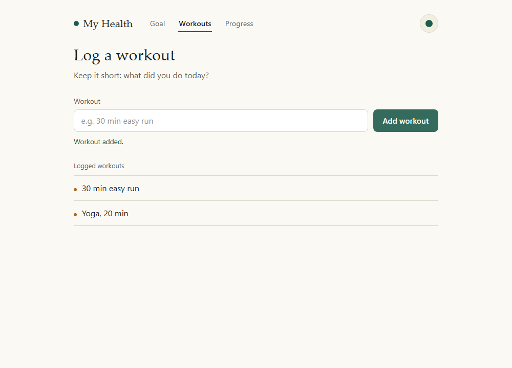
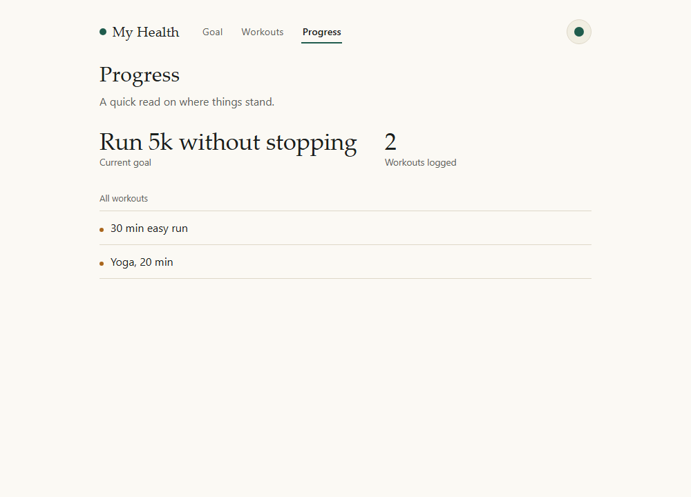
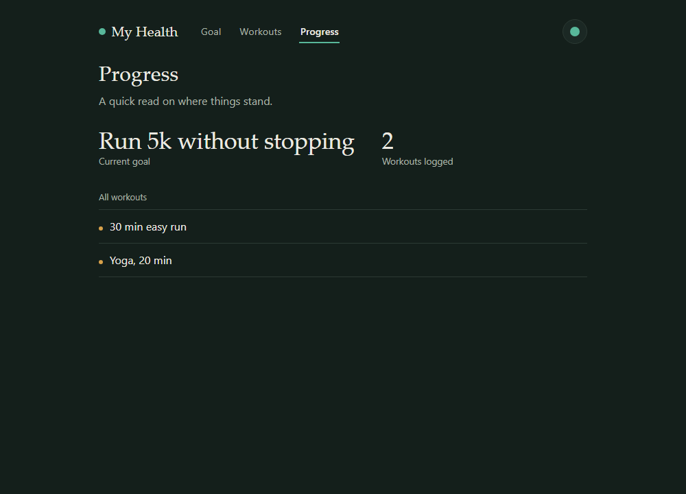

# My Health — Fitness Tracker


A small browser-based fitness tracker: set a goal, log your workouts, and see your progress at a glance. Built as a university Agile Software project and since restored, debugged, and given a modern interface.

## Overview

My Health helps someone stay accountable to a single fitness goal by giving them a quick place to write it down, log workouts as they happen, and see a running count of progress. It has no backend — everything lives in the browser, persisted to `localStorage` so a page refresh doesn't wipe your log.

## Features

- **Set a fitness goal** — write down what you're working toward (e.g. "Run 5k without stopping"); it stays visible across the app.
- **Log workouts** — add a short entry per workout; entries are timestamped in the order you add them.
- **Progress report** — see your current goal and total workouts logged, plus the full workout log.
- **Input validation** — empty submissions are rejected with an inline message instead of silently doing nothing.
- **Persistence** — your goal and workout log survive a page reload (saved to `localStorage`).
- **Light and dark themes** — toggle in the header; respects your OS preference by default.

## Screenshots

| Goal — empty state | Goal — validation error |
|---|---|
|  |  |

| Goal set | Workouts — empty state |
|---|---|
|  |  |

| Workouts logged | Progress |
|---|---|
|  |  |

| Dark theme |
|---|
|  |

## Tech stack

- **HTML5** — single-page structure (`index.html`)
- **CSS3** — custom properties for theming, no framework (`css/styles.css`)
- **JavaScript (ES6+)** — vanilla DOM scripting, no build step (`js/script.js`)
- **Browser `localStorage`** — client-side persistence, no database
- **Playwright** (dev-only) — used to generate the screenshots above

## Project structure

```
My-Health/
├── index.html              # Single-page app entry point
├── css/
│   └── styles.css          # Theme tokens, layout, components
├── js/
│   └── script.js           # Core logic: goals, workouts, progress, theme, tabs
├── docs/
│   └── screenshots/         # App screenshots used in this README
├── scripts/
│   └── screenshot.mjs      # Playwright script that generates the screenshots
├── package.json            # Dev tooling only (screenshot script)
├── LICENSE
└── README.md
```

## Prerequisites

None to run the app — it's a static site. To regenerate screenshots you'll need [Node.js](https://nodejs.org/) 18+.

## Installation & running

1. Clone the repo:
   ```bash
   git clone https://github.com/hassanxadel/My-Health.git
   cd My-Health
   ```
2. Open `index.html` directly in a browser, **or** serve it locally:
   ```bash
   npx serve .
   ```
3. No build step, no server required for normal use.

### Regenerating screenshots (optional)

```bash
npm install
npx playwright install chromium
npm run screenshots
```

## How to use

1. Go to the **Goal** tab, type what you're working toward, and click **Set goal**.
2. Go to the **Workouts** tab, describe a workout, and click **Add workout**. Repeat for each session.
3. Go to the **Progress** tab to see your current goal, total workouts logged, and the full list.
4. Use the circular button in the header to switch between light and dark themes.

## Testing

This is a static client-side app with no test runner configured. To verify behavior manually:
- Submit the goal/workout forms empty and confirm the inline validation message appears.
- Set a goal, add workouts, reload the page, and confirm both persist.
- Toggle the theme and reload — the choice should persist.

## Restoration notes

This project was originally a single inline-styled HTML file, duplicated across `tracker.html` and `html/tracker.html`, with an unused `css/styles.css` and `js/script.js` that were never linked. Restoration work:

- **Removed duplicates**: deleted `tracker.html` (root) and `html/tracker.html` — identical copies of the same inline page, fully superseded by the new `index.html`.
- **Wired up the previously dead files**: `css/styles.css` and `js/script.js` are now the real, linked stylesheet and script (they were orphaned before).
- **Fixed data loss on refresh**: goal and workout state now persist to `localStorage`; previously everything lived only in memory and vanished on reload.
- **Added input validation**: empty goal/workout submissions are rejected with a visible message instead of writing blank entries.
- **Modernized the GUI**: replaced the single unstyled form with a tabbed Goal / Workouts / Progress layout, a logbook-style visual language (warm paper background, deep teal accent, serif headings for the goal), light/dark theme support, and accessible focus states — all calling the same core `setFitnessGoal` / `recordWorkout` / `updateProgressReport` logic from the original app.
- No core logic, language, or feature was removed — only duplication and dead code.

## Known limitations & future improvements

- Single-user, single-goal model — no accounts or multiple concurrent goals.
- No workout metadata (duration, intensity, date) beyond a free-text description, matching the original app's scope.
- No backend — data is local to one browser and is lost if site storage is cleared.
- Possible future additions: workout categories/duration tracking, a simple chart of workouts over time, exporting/importing logged data.

## Author

**[Your Name]**
[Your GitHub](https://github.com/hassanxadel) · [Your LinkedIn](#) · [Your Email](#)

## License

MIT — see [LICENSE](LICENSE).
